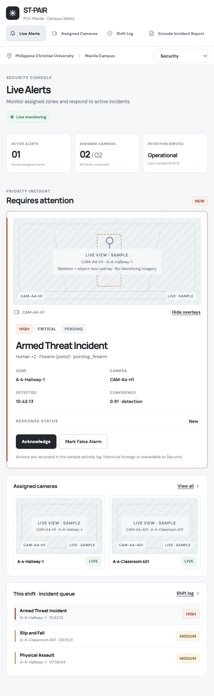

# ST-PAIR UI prototype

An interactive, desktop-first campus surveillance interface based on the supplied design plan and screenshots. It includes role-specific navigation for Security Personnel, Administrator, System Administrator, Faculty, and Student.



## Run locally

```bash
npm install
npm run dev
```

Open the local URL printed by Vite. Use the role selector in the header to explore the five interfaces. The Student view includes a “Switch demo role” link.

```bash
npm test
npm run build
```

## Prototype behavior

- Security can acknowledge and progress a sample incident, view assigned camera placeholders, inspect a shift log, and encode a report.
- Administrators can filter incident records, inspect a detail view, view sample analytics, export sample CSV data, and review configuration requests.
- System Administrators can inspect zones, adjust polygon vertices, and submit zone or rule changes for approval.
- Faculty can acknowledge receipt of a zone alert. Student sees a verified urgent sample notice without surveillance footage.
- Severity rule submissions and Faculty receipt acknowledgements require an explicit confirmation. Cancel keeps the form or alert unchanged.

All records and visuals are synthetic examples. Changes last only until the page reloads. There is no CCTV connection, detection service, authentication backend, persistent storage, real notification routing, or production authorization. The navigation and data exposure model demonstrate the planned permissions; server-side enforcement is required before deployment.

Institutional decisions remain necessary for incident taxonomy, severity thresholds, student verification and instructions, contact information, retention, and report privileges.
